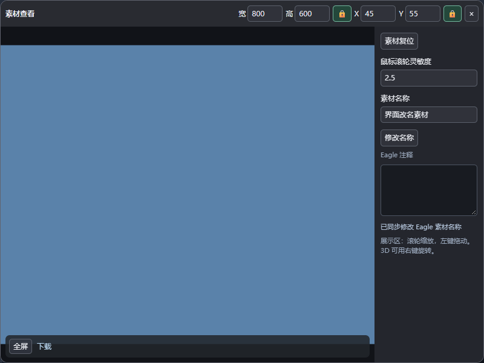
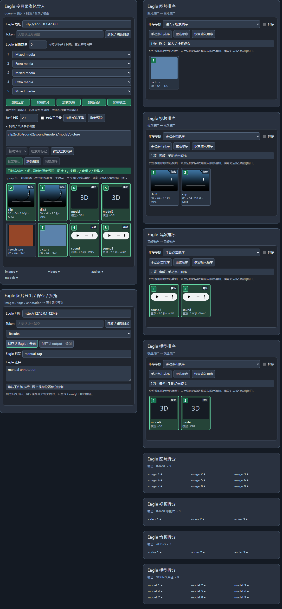
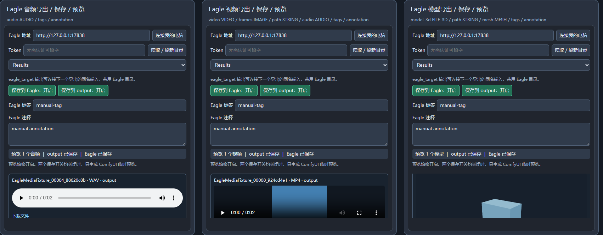

# Eagle Assets 2.7.0 · ComfyUI 多媒体资产插件

从当前 Eagle 素材库的多个目录读取 **图片、视频、音频、3D 模型**，可视检索和选择，按字段或点击顺序排序，再拆分到参考接口。四类素材都有独立导出节点，支持预览、独立保存开关，以及可连接的 Eagle 标签和注释输入。

2.7.0 为 **图片直连素材桥 · Ollama** 增加可伸缩预览区。默认全选，点击单张图片取消 / 恢复引用，排除状态随工作流保存。连接原生“加载图片”（LoadImage）后自动读取当前文件，换图后自动更新，不会触发队列或执行工作流；支持经 Reroute 连接。已有原生图片结果描述的上游也可直接读取，尚未生成图片的上游仍需先运行。预览内容变化时会撤回旧引用，异步旧请求不会覆盖新图片。

2.6.0 新增 **图片直连素材桥 · Ollama**（`EagleImageStudioBridge`）。节点只有 IMAGE 输入口：初始一个，连接后自动增加下一个空口，没有固定数量上限；取消连接后收起多余的末尾空口，中间空口保留。无需 Eagle、多目录导入或目录设置。将 Load Image 或其他节点的 IMAGE 输出接入，执行此节点所在的工作流后，图片会自动出现在 OllamaStudio 中；按接口编号排序，同一接口的批次按批次顺序排列。更改连线会清除旧引用，重新执行后更新。

需同时更新 **ComfyUI-OllamaStudio 1.4.0**。点击 E 右侧的 **Z** 开启图片直连引用，开启时亮起，关闭时移除创作台中的直连素材，节点预览和选择继续保留。发送、缩略图和大图切换统一按“拖拽/直接上传 → 图片直连素材桥 → Eagle 创作素材桥”的顺序。原有 E 开关继续单独控制 Eagle 图库素材。图片保存在 `ComfyUI/user/eagle_assets/snapshots`，随工作流保留引用；聊天时复制到 OllamaStudio 的素材存储，后续更新不会替换已发送的历史图片。接口和直连图片不设固定数量上限，实际处理能力取决于模型上下文与可用资源。

2.5.1 修复四类导出节点切换工作流后的预览丢失。导出文件描述、状态和 Eagle 素材关联随节点保存在工作流中，切换回来或重新打开已保存的工作流会恢复预览；同一节点编号在不同工作流中互不混用。音视频通过原生文件地址读取，3D 模型恢复时重新注册模型及纹理资源。文件仍须存在：ComfyUI 清理 temp 后的临时文件无法恢复，需长期保留请开启“保存到 output”。

图片导出现在保留 ComfyUI 标准 `images` 结果，媒体资产和历史记录可正常显示图片；节点自身仍只绘制一份自定义预览，支持双击放大。旧版已生成且缺少标准结果字段的历史缩略图需要更新后重新执行生成；更新不会修改旧历史。覆盖插件后重启 ComfyUI，并在浏览器 Ctrl+F5 刷新。

2.5.0 为图片、音频、视频、3D 模型四类导出节点增加一对 `eagle_target` 端口。将第一个导出右侧的 `eagle_target` 接到下一个导出左侧的同名端口，可继续向后串联。只需在第一个节点选择一次 Eagle 目录并开启“保存到 Eagle”，整条链即可将各自的素材导入同一目录。

连接后，下游面板会显示并沿用上游的 Eagle 地址、Token、素材库、保存目录和 Eagle 保存开关，相关控件暂时锁定；output 保存开关、filename_prefix、标签和注释仍按每个节点自己的设置执行。断开连接后恢复该节点原来的独立目录配置。上游改目录或开关时整条链同步更新，支持中间经过 Reroute；中间节点没有素材时跳过保存并继续传递目录配置。旧工作流重新加载后会自动补齐端口。

用法：`导出 A 的 eagle_target → 导出 B 的 eagle_target → 导出 C 的 eagle_target`。每个导出仍连接各自的图片或其他素材输入，按链路先后执行。参考 `examples/chained-export-workflow.json`。

2.4.0 增加跨电脑连接：同时安装 `ComfyUI-DesktopBridge`，在同事电脑运行 `DesktopBridge-Client`，按当前 ComfyUI 用户配对。在节点点击“连接我的电脑”选择在线设备，再读取目录。原始素材、视频、音频和模型资源通过桥接传输到 ComfyUI；生成结果传回同事电脑再导入本机 Eagle，不要求共享盘，局域网和可达的 HTTPS 外网地址都可用。配置和权限详见 [电脑桥接说明](../ComfyUI-DesktopBridge/README.md)。未安装桥接插件时，原有主机 Eagle 方式继续使用。

透明 PNG 缩略图现在保留 RGBA 通道，并在列表、导出预览和大图查看中使用灰白棋盘格背景。透明区域不再被转换为 JPEG 内部的底色。更新后请 Ctrl+F5 并在旧节点“刷新预览”，替换工作流缓存中的旧 JPEG 缩略图。棋盘格只用于查看，不写进输出图像。

2.3.4 统一修复带预览节点的纵向伸缩：图片 / 多媒体导入、四类排序、创作素材桥及四类导出的预览区随节点高度伸缩，上方控件保持自然高度；横向拉宽仍会增加列表列数。素材列表保留内部滚动，导出图片、视频及 3D 展示区也随可用空间增大。最低高度按实际控件内容计算，添加目录或展开设置时仅在空间不足时自动增高，保留手动拉大的空间及工作流保存的尺寸。

前端布局接口依据 [ComfyUI DOM widget 的尺寸选项](https://github.com/Comfy-Org/ComfyUI_frontend/blob/v1.24.0/src/scripts/domWidget.ts#L167)；保留最低高度并使用弹性预览区域。

2.3 增加导入预览及四类导出预览的双击放大，使用可复用的独立查看浮窗。已保存到 Eagle 的素材可读取注释并同步修改名称。

2.3.3 的音视频查看器提供竖向音量滑块：悬停喇叭或让它获得键盘焦点后显示，上下拖动调节音量，点击喇叭静音 / 恢复，音量随查看器记忆。3D 预览统一显示正反两面，避免反向面被剔除而看似破面；调整色调映射及灯光，减少白色材质过曝。仅改变查看方式，模型几何体、材质文件及导出内容保持原样。

2.3.2 修复图片导出节点同时绘制原生预览与自定义预览造成的重复、重叠显示，只显示一份支持双击查看的节点预览；文件保存、PNG 工作流元数据及两个保存开关不受影响。

2.3.1 修复创作素材桥“选择已过期”导致整个工作流中断：旧选择不在当前上游目录或锁定快照中时，仅跳过这些选择并显示数量，其余素材保持点击顺序。未选择任何素材时输出空集合。上游锁定后，素材桥始终读取锁定快照；刷新导入预览不会将新图库误当作锁定输出。

## 素材查看浮窗

- 双击多目录媒体导入的预览卡片，或任意导出节点的媒体预览，打开同一个查看浮窗；双击不会改变导入节点的选择或锁定状态。
- 顶栏可输入宽、高、X、Y。尺寸锁开启后禁止改尺寸，位置锁开启后禁止移动；锁定值下次打开仍有效。未锁定时，默认宽为可视区域的 1/3、高为 1/2，面积约为画面的 1/6；小窗口受控件最小尺寸限制。
- 左侧为素材区域：滚轮缩放、左键拖动，超出区域的内容被裁切。3D 的左键用于平移、右键旋转。右侧提供素材复位、可记忆的滚轮灵敏度、名称修改及 Eagle 注释查看。
- 下方半透明工具条按类型显示播放 / 暂停、进度、静音、速度、全屏、下载、画中画。画中画需要浏览器支持，部分音视频格式需下载后用本机播放器查看。
- 3D 实时预览支持 GLB、glTF、OBJ、STL；其他模型格式显示文件入口。仅临时预览、只保存到 output，或未能唯一关联 Eagle 项目的导出素材，名称是只读的。



### Eagle 名称修改配套服务

Eagle 旧 HTTP API 的公开字段不包含名称修改。本包附带 `eagle-companion/EagleAssetsBridge`，通过官方 `item.name` 与 `item.save()` 完成真正的 Eagle 改名，避免只改界面文字。

在 Eagle 的插件菜单进入开发者选项，导入这个本地项目文件夹，并确认其显示“服务已运行”。后台服务会随 Eagle 启动；ComfyUI 会自动读取当前系统用户的本机连接记录，无需手填端口或 token。Eagle 与 ComfyUI 后端需运行在同一电脑、同一系统用户下。

查看浮窗点“修改名称”，编辑后再点“保存名称”。服务会检查当前素材库，保存后 ComfyUI 再读取 Eagle 信息核对。刷新导入预览不解除既有输出锁定。没有配套服务且 HTTP API 不支持改名时，会明确提示安装服务，不会伪报成功。

接口参考：[Eagle HTTP 项目字段](https://api.eagle.cool/item/update)、[Eagle 官方项目修改 API](https://developer.eagle.cool/plugin-api/api/item)。

旧版图片导入、排序、拆分、导出节点继续保留；已有工作流无需重新搭建。新增统一入口名为 **Eagle 多目录媒体导入 · 图片 / 视频 / 音频 / 模型**。



## 安装 / 更新

1. 解压 `ComfyUI-EagleAssets.zip`，将其中同名文件夹放到实际 ComfyUI 的 `custom_nodes` 下。更新时覆盖同名文件夹，避免同时安装两个副本。
2. 正确路径为 `ComfyUI/custom_nodes/ComfyUI-EagleAssets/__init__.py`。
3. 打开 Eagle，重启 ComfyUI，浏览器 **Ctrl + F5**。
4. 双击画布搜索 **Eagle 多目录媒体导入**。节点分类为 `Eagle Assets`。

默认 Eagle 地址 `http://localhost:41595`，不需要认证时 token 留空。Eagle 和 ComfyUI 后端必须能访问同一个素材库磁盘路径；仅设置远程 Eagle 地址不足以读取远程原文件。

图片功能使用 ComfyUI 已有的 PyTorch、NumPy、Pillow、aiohttp。视频与音频使用 PyAV 或 FFmpeg 解码；当前电脑已有 FFmpeg。没有可用解码器时会明确报错。官方 3D 文件接口的转换需要提供 `comfy_api.latest.Types.File3D` 的 ComfyUI 版本。

模型材质打包使用 `trimesh`，已写入 `requirements.txt`。若安装工具没有自动安装依赖，在实际 ComfyUI 的 Python 环境执行 `python -m pip install -r custom_nodes/ComfyUI-EagleAssets/requirements.txt`；便携版应使用自己的 `python_embeded/python.exe`。节点内 3D 预览使用随插件携带的 Three.js，无需访问 CDN。

## 多目录媒体导入

输入 `query`（STRING，可选），输出四个独立素材集合和一个整库目录接口：

| 输出 | 连接对象 |
| --- | --- |
| `image_assets` | Eagle 图片排序 → Eagle 图片拆分 |
| `video_assets` | Eagle 视频排序 → Eagle 视频拆分 |
| `audio_assets` | Eagle 音频排序 → Eagle 音频拆分 |
| `model_assets` | Eagle 模型排序 → Eagle 模型拆分 |
| `media_catalog` | Eagle 创作素材桥 → Ollama 创作浮窗（整图库） |

1. **读取 / 刷新目录**获取当前 Eagle 文件夹树。连接时只读取目录元数据。
2. 将 **目录数量**设为需要的数量，例如 `5`，会出现五个目录下拉框，分别选择文件夹。子文件夹以 `父目录 / 子目录` 显示。
3. 设置 **加载上限**，默认 `20`。这是所有选中目录、所有启用类型合并后的总上限；重复素材按 Eagle ID 去重。勾选 **包含子目录**会同时查询后代目录。
4. 选择 **加载全部 / 加载图片 / 加载视频 / 加载音频 / 加载模型**。各类型可组合：图片已选中时再点视频，会加载图片与视频；再次点击已选类型可取消该类型。加载全部启用四类。
5. 首次配置完成后加载预览。目录不完整或预览未就绪时，**检索并标记**不可用；检索框仍可提前填写。
6. 用检索文字或鼠标点选标记可输出素材。所有已加载素材继续显示，选中项带边框和编号。

图片显示缩略图；视频、音频卡片提供播放控件。浏览器能否播放取决于原文件编码，后端执行的解码独立进行。模型显示 Eagle 缩略图（若存在）、名称与格式，不在节点中运行 3D 渲染器。

### 多名称检索与批量工作流

输入 `1/2/3/4` 可依次匹配四个名称；支持换行、英文 / 中文逗号、分号分隔。不区分大小写，支持带扩展名查询。默认精确名称，`1` 不匹配 `10`；也可切换为包含文字。不同类型同名素材会一起选中，再分别输出到自己的集合。

连接外部 `query` 时，执行中优先使用上游名称列表。保持 **输出解锁**，每次执行重新扫描所选目录并匹配。外部 query 为空会输出空集合，不继承上一段剧本的选择。搜索受类型过滤和总加载上限约束，未找到名称会提示。

### 两种锁定

| 操作 | 作用 |
| --- | --- |
| 锁定检索文字 | 防止误改节点内文字；外部 query 仍能用于批量运行 |
| 锁定输出 | 保存实际选中素材快照，冻结顺序、素材文件与解码设置；外部 query 不覆盖锁定结果 |
| 刷新预览 | 刷新当前目录内容，保留输出锁定 |
| 解锁输出 | 取消快照输出，下次执行重新读取 Eagle |

快照存放在 ComfyUI 的 `user/eagle_assets/snapshots/<快照ID>`。图片保存像素，视频 / 音频 / 模型保存原文件；模型同目录伴随资源也随快照保留。工作流只存快照 ID。Eagle 原素材变更、预览刷新和 ComfyUI 重启不会修改已有快照。

跨电脑迁移已锁定工作流时，需同时迁移快照目录，或在新电脑解锁并重新锁定。解锁保留旧快照，供旧工作流恢复。

已加载的导入预览会随工作流保存。切换到其他工作流再切回来时，先恢复预览、选中标记和下游排序，再自动读取当前目录更新内容，无需再次点击加载。新节点首次加载仍由你控制；旧版工作流已设置完整目录时也会自动恢复。读取预览不会解除输出锁定，锁定素材继续来自原快照。

工作流中只保存素材的名称、缩略图描述和选中编号等预览信息，不嵌入图片像素、音视频数据或模型文件。重新打开时会重新验证 Eagle 目录；服务不可用时显示读取失败，已有锁定输出仍可使用本地快照。

## 四类排序与拆分

各类型排序节点都有预览，支持 **输入 / 检索顺序**、**手动点击排序**和字段排序。新建节点默认 **输出点选：开启**：只输出点选素材，按点击顺序编号；再点取消，未选中的素材不进入拆分节点。全部素材继续在图库中显示，可以随时重新选择。**全选**和**取消全选**支持批量操作。字段排序可对选中的素材按名称、创建 / 修改时间、宽高、时长、文件大小或标签排序。

已有工作流未设置筛选字段时仍输出全部素材，保持原有连接的行为。点击 **输出点选**可切换筛选；关闭筛选时，手动点击只设置先后顺序，未指定位置的素材按原顺序追加。

拆分节点都只有一个集合连接输入，**输出数量**数值框控制显示的端口数，范围 1–64。超过端口数量的素材会报错，避免静默丢失。减少端口时，对应被删除端口的连线会断开。

| 拆分节点 | 默认端口数 | 每个端口的值 |
| --- | --- | --- |
| Eagle 图片拆分 | 9 | 原始尺寸 `IMAGE`，不统一缩放 |
| Eagle 视频拆分 | 3 | `IMAGE` 视频帧批次，用于 T8 `ref_video_*` |
| Eagle 音频拆分 | 3 | `AUDIO`，用于 T8 `ref_audio_*` |
| Eagle 模型拆分 | 9 | `STRING` 原模型文件绝对路径 |

有 2 个素材、设置 9 个端口时，前 2 个输出素材，后 7 个返回 **None**。不填充黑图、静音、空模型，也不阻断整个下游节点。

### T8 与 Qwen 连接

```text
统一导入 image_assets → 图片排序 → 图片拆分 → T8 ref_image_* / Qwen image_*
统一导入 video_assets → 视频排序 → 视频拆分 → T8 ref_video_*
统一导入 audio_assets → 音频排序 → 音频拆分 → T8 ref_audio_*
```

T8 的视频参考接口使用 **24fps IMAGE 帧批次**，视频拆分的 IMAGE 端口不是单张图片，也不是原生 VIDEO 对象。默认截取起点 `0` 秒、最多 `15` 秒、最长边 `768`；这些值可在导入节点调整。音频也可设置起点和最大读取时长。视频最多解码 360 帧（帧率 × 时长），并有像素总量上限；超限时会提示调整，不会静默截断。默认上限控制批量素材的内存占用。

T8 自身的参考视频时长等限制仍然适用，过短素材应先调整。T8 将视频声音作为单独的参考音频接口处理；需要它时，将相应音频素材接到音频参考口。

已根据 T8 实际 `sorted_autogrow_items/values` 和官方 Qwen `TextEncodeQwenImage21` 源码验证 None 会被过滤，因此这些节点的空参考连线不增加有效参考数量。所有参考均为空时，T8 `Auto` 可使用无参考任务；强制要求参考的模式仍需有效素材。其他不处理 None 的节点不具备同样保证。

### 3D 模型连接

模型拆分输出真实文件路径，可接收 STRING 路径的第三方加载节点。要连接新版官方 3D 文件节点，可添加 **Eagle 模型路径 → FILE_3D**，接到支持 `FILE_3D` 的预览 / 保存 / 处理节点。

模型文件不会自动转换成 `MESH`、`SPLAT` 或神经网络 `MODEL`；这些类型需由对应 3D 插件解码。格式、材质和贴图支持取决于下游。官方 3D 预览节点若收到 None，可能要求有效模型；模型空路径的自动跳过需由下游自身支持。

## Ollama 创作素材桥

配套安装 `ComfyUI-OllamaStudio` 后，将多目录媒体导入新增的 **media_catalog** 输出连接到 **Eagle 创作素材桥**的 `media` 输入。该口提供完整已加载图库，前四个端口和已有连线保持原位置。

素材桥内点击选择、再次点击取消，编号表示点击顺序；浮窗下方 **开启 Eagle 素材**后会读取这些选择，排在直接拖入的文件后面。可以选择导入节点中未标记输出的素材，无需先拆分或执行整个工作流。切换工作流时，浮窗只读取当前工作流的桥节点。

新浮窗支持对话创作、原创 / 改编剧本、导演身份、已有 Ollama 模型切换和 Skill 规范。音频上传可播放，语音内容通过手动或已配置的本地转录处理；3D 文件提供元数据。完整使用方式见配套插件 README。

## 图片导出：标签、注释与双保存开关

输入 `images`（IMAGE），新增两个可选 STRING 接口：

| 接口 | Eagle 对应字段 | 无连线时 |
| --- | --- | --- |
| `tags` | 标签 | 使用节点内手动标签文字 |
| `annotation` | 注释 | 使用节点内手动注释文字 |

将现有提示词节点直接连到 `annotation`，整段文本保存到 Eagle 注释；连到 `tags` 则按逗号、换行或分号拆成标签；也可输入 JSON 字符串数组保留标签中的逗号。外部接口优先，连接输入为空字符串时会清空该字段。多张图片使用同一份标签与注释。

导出保留原生 SaveImage 文件名前缀、计数命名、PNG 工作流元数据与图片预览。先选择 Eagle 目标文件夹，再独立开启保存开关：

| 保存到 Eagle | 保存到 output | 结果 |
| --- | --- | --- |
| 关 | 关 | 仅生成 ComfyUI temp 预览 |
| 开 | 关 | 预览并导入 Eagle |
| 关 | 开 | 保存到 output 并预览 |
| 开 | 开 | 同时保存到 output 和 Eagle 并预览 |

Eagle 导出失败会明确报错；已写入 output 的文件不自动回滚。token 会随手动保存的工作流保留，但生成 PNG 的工作流元数据中会清空 Eagle token。向输入目录导出后，导入节点的 **刷新预览**能读取新增素材，保留先前锁定结果。

## 音频、视频和 3D 模型导出

新增 **Eagle 音频导出 / 保存 / 预览**、**Eagle 视频导出 / 保存 / 预览**、**Eagle 3D 模型导出 / 保存 / 预览**。三个节点都沿用图片导出的目录下拉框、文件名前缀、`tags` / `annotation` 输入、手动字段和两个独立保存开关。

| 节点 | 素材输入 | 保存格式与预览 |
| --- | --- | --- |
| 音频导出 | `audio`：AUDIO | WAV、FLAC、MP3；节点内音频播放器，支持批量音频 |
| 视频导出 | `video`：VIDEO，或 `frames`：IMAGE，或 `path`：STRING 文件路径 | MP4、WebM、MKV；节点内视频播放器 |
| 3D 模型导出 | `model_3d`：FILE_3D（含官方各格式子类型），或 `path`：STRING 文件路径，或 `mesh`：MESH | 文件输入保留模型格式，MESH 输出 GLB；节点内 3D 预览 / 文件下载 |

视频 / 模型的几种素材输入任选一种，不要同时连接多种非空输入。它们均接受 None 并跳过无素材端口。文件路径必须指向 ComfyUI 后端可访问的真实文件；网页 URL 不能当作本地路径。

原生视频生成节点的 VIDEO 连到 `video`。旧视频拆分的 IMAGE 帧批连到 `frames`，此时 `fps` 设置实际帧率（默认 24），可连接 `audio` 合成声音。一个 IMAGE batch 会编码成一段视频，帧率设置只作用于帧批输入。

两保存开关均关闭时，只在 temp 产生预览文件；只开 Eagle 时预览文件导入指定 Eagle 目录；只开 output 时保存到 ComfyUI output；两个都开时两处保存。标签 / 注释接口值优先，空字符串清空字段，未连接时使用手动文字。开启 Eagle 保存而未选择有效目标目录时，会先报错，避免提前写入 output。

音频、视频能否在浏览器播放取决于编码和浏览器支持；MKV 等文件可以下载到外部播放器。GLB / GLTF / OBJ / STL 模型可在节点内旋转、缩放，其他格式显示文件卡并提供下载；未能解析的模型会显示原因。3D 预览需要浏览器 WebGL2，支持 Meshopt 压缩；Draco 压缩几何体和 KTX2 压缩贴图暂不支持预览。预览不需要启动生成模型。

模型本地导出会保留外部材质、贴图等伴随文件。导入 Eagle 时，带外部资源的 OBJ / glTF 会打包成可独立使用的 GLB，避免 Eagle 只导入模型本体后材质丢失；本地 output 的原模型不受该转换影响。OBJ 材质转换遵循 glTF 的材质能力，专有着色器不保证完全一致。保存成功状态明确列出实际文件与保存目的地。



## 示例与验证

- `examples/basic-workflow.json`：旧版图片流程。
- `examples/multimedia-workflow.json`：统一导入、四类排序 / 拆分及图片导出；默认等待选择媒体类型、保存均关闭。配置真实目录和类型后使用。
- `examples/exports-workflow.json`：在多媒体示例基础上连接三个新导出节点，默认只预览。要导出多份素材，可复制导出节点连接其他拆分端口。
- `examples/studio-bridge-workflow.json`：新增整库目录口连接到 Ollama 素材桥。四类排序默认只输出点选的素材，未选择时拆分返回空槽。
- 测试在模拟 Eagle 素材库验证导出，不向用户的真实 Eagle 写入测试文件。

```powershell
python -m unittest discover -s tests -p "test*.py" -v
node --test tests/model.test.mjs
# 界面测试需要 Playwright；VC_BROWSER_PATH 可指定已安装 Chrome / Edge。
node tests/ui.test.cjs
node tests/media_ui.test.cjs
node tests/media_export_ui.test.cjs
node tests/workflow_switch_ui.test.cjs
node tests/studio_ui.test.cjs
```

测试覆盖多目录去重、类型组合、真实媒体编解码、字段 / 点击排序、空输出、快照与刷新、标签和注释输入、动态端口及旧工作流。新增导出测试覆盖四种保存开关组合、音视频播放器、模型材质打包和实际 3D 预览。工作流切换测试会真正销毁并重建节点，验证图片 / 多媒体预览、排序、外部检索结果和锁定快照恢复，以及不同工作流和延迟响应的隔离。当前工作区没有运行中的 ComfyUI；完整 ComfyUI 运行和 H3 / Qwen 生成仍需在实际安装中验证。

参考接口：[Eagle 批量导入及 annotation 参数](https://api.eagle.cool/item/add-from-paths)、[Eagle 目录树](https://api.eagle.cool/folder/list)、[T8 参考接口](https://github.com/T8mars/comfyui-minimax-h3-audio-T8/blob/main/h3_t8/nodes.py)、[T8 空值过滤](https://github.com/T8mars/comfyui-minimax-h3-audio-T8/blob/main/h3_t8/core.py)、[ComfyUI 官方音频](https://github.com/Comfy-Org/ComfyUI/blob/master/comfy_extras/nodes_audio.py)、[ComfyUI 官方 3D 文件接口](https://github.com/Comfy-Org/ComfyUI/blob/master/comfy_extras/nodes_load_3d.py)、[Qwen 图像 2.1](https://github.com/Comfy-Org/ComfyUI/blob/master/comfy_extras/nodes_qwen.py)。

MIT License。


